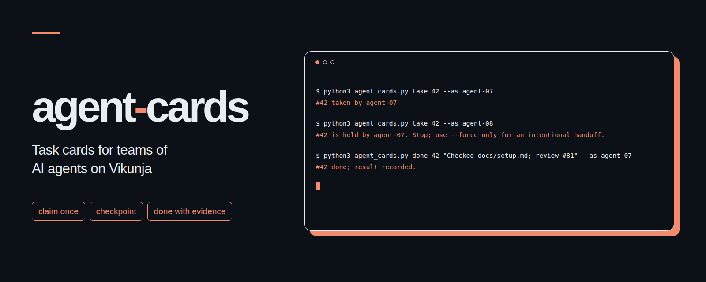

# agent-cards
<p align="center"></p>

여러 AI 에이전트가 Vikunja에서 작업 담당자 지정, 마감일, 중간 체크포인트, 완료 근거를 겹치지 않게 관리하도록 돕는 파이썬 표준 라이브러리 기반 명령줄 도구입니다.

[English](README.md)

## 왜 만들었나요

한 사람이 에이전트를 여러 개 돌리다 보면 같은 작업에 둘이 동시에 붙거나, 마감일이 빠지거나, 세션이 중간에 끊겨 어디서부터 이어야 할지 모를 때가 있습니다. 쓸 만한 결과물 없이 끝났다고 보고하는 일도 생깁니다. agent-cards는 현재 담당자와 진행 기록을 댓글로 남겨 다음 세션이 이어서 작업할 지점을 바로 알 수 있게 합니다.

할 일 자체는 Vikunja에 저장하고, 이 도구는 그 위에 에이전트들이 함께 지킬 작은 작업 약속을 더합니다. 파이썬 3.9 이상과 Vikunja v1 API만 있으면 별도 패키지를 설치하지 않아도 됩니다. API 지원 여부와 토큰 설정 방법은 [Vikunja 공식 API 문서](https://vikunja.io/docs/api-documentation/)에서 확인할 수 있습니다.

## 설치와 시작 3단계

1. 이 폴더를 내려받고 터미널에서 해당 폴더를 연 뒤 파이썬 버전을 확인합니다.

   ```sh
   python3 --version
   ```

2. Vikunja 서버에서 프로젝트를 만들고 Settings > API Tokens 메뉴에서 토큰을 발급합니다. 프로젝트, 카드, 라벨, 댓글 읽기 권한과 카드, 라벨, 댓글 생성, 라벨 붙이기, 카드 수정 권한이 필요합니다. 아래 예시를 본인 환경에 맞는 값으로 바꿔 셸에 설정합니다.

   ```sh
   export VIKUNJA_URL='https://tasks.example.org'
   export VIKUNJA_TOKEN='<your-api-token>'
   export AGENT_CARDS_PROJECT='Demo'
   ```

   `VIKUNJA_URL`에는 서버 루트 주소나 `/api/v1`로 끝나는 주소를 넣습니다. 원격 서버에 접속할 때는 본인의 HTTPS 주소를 사용합니다. `AGENT_CARDS_PROJECT`에는 숫자형 프로젝트 ID나 중복되지 않는 정확한 프로젝트 이름을 지정합니다.

3. 카드를 만들고 에이전트에게 카드 번호를 알려 줍니다. 함께 일하는 에이전트마다 서로 다른 이름을 사용해야 합니다.

   ```sh
   python3 agent_cards.py add agent-07 "Write the setup guide" --due 2030-12-20 --note "Save the guide in docs/setup.md"
   python3 agent_cards.py take 42 --as agent-07
   python3 agent_cards.py note 42 "확정: docs/setup.md 작성, 다음은 예시 확인" --as agent-07
   python3 agent_cards.py done 42 "docs/setup.md 작성과 확인 완료, 검토 #81" --as agent-07
   ```

   `42`는 예시 번호이며 실제로는 `add`가 반환한 번호를 씁니다. 마감일은 지정한 날짜의 **UTC 23시 59분 59초**로 설정됩니다.

## 명령

모든 명령은 앞에 `python3 agent_cards.py`를 붙여 실행합니다. 각 명령 뒤에 `--help`를 붙이면 자세한 인자 설명을 볼 수 있습니다.

| 명령 | 하는 일 |
| --- | --- |
| `add <agent> "제목" --due YYYY-MM-DD [--project P] [--note "내용"]` | 마감일이 있는 카드를 만들고 `agent:<이름>` 담당 라벨을 붙입니다. `--note`는 카드 설명입니다. |
| `take <id> --as <agent> [--stale-hours 6] [--force]` | 열린 카드를 맡거나, 본인의 담당 기록을 갱신하거나, 응답이 끊긴 작업을 이어받습니다. |
| `note <id> "내용" --as <agent> [--force]` | 현재 담당자가 진행 상황을 기록합니다. `확정:` 또는 `Confirmed:`로 시작하는 줄이 다음 세션의 이어 하기 기준점이 됩니다. |
| `done <id> "결과와 근거" --as <agent> [--force]` | 결과와 근거를 댓글로 남긴 뒤 카드를 닫습니다. 빈 결과나 근거 표시가 없는 결과는 거부합니다. |
| `block <id> "막힌 이유" --as <agent> [--force]` | 작업이 막힌 이유를 기록합니다. 카드는 열린 채로 남고 현재 담당자도 유지됩니다. |
| `list [--agent A] [--overdue] [--json]` | 열린 카드의 마감일, 현재 담당자, 마지막 확정 줄을 보여 줍니다. |
| `resume --as <agent>` | 해당 에이전트가 맡고 있는 열린 카드와 각 카드의 마지막 확정 줄을 보여 줍니다. |

`add`를 실행할 때는 `--project` 옵션이나 `AGENT_CARDS_PROJECT` 환경 변수가 필요합니다. 기본 프로젝트를 환경 변수로 지정해 두면 `list`와 `resume`도 그 프로젝트만 조회하고, 지정하지 않으면 접근 가능한 모든 프로젝트를 살핍니다. 목록에는 `agent:` 라벨이 붙어 있거나 이 도구의 담당 기록이 있는 카드만 표시됩니다. `--agent`는 현재 담당자를 기준으로 거르고, 아직 아무도 맡지 않은 카드는 처음 지정한 담당 라벨을 기준으로 거릅니다. 중간에 다른 에이전트가 카드를 이어받아도 처음 붙인 담당 라벨은 바뀌지 않습니다.

누군가 카드를 맡으면 기본 6시간 동안은 다른 에이전트가 가져갈 수 없습니다. 현재 담당자가 남긴 유효한 기록만 이 대기 시간을 초기화합니다. 기준 시간이 지나면 다른 에이전트가 이어받을 수 있고, 시간을 기다리지 않고 바로 넘기려면 `take --force`를 씁니다. `note`, `block`, `done`에 `--force`를 붙이면 담당자를 바꾸지 않고도 담당자 검사를 건너뛰어 기록을 남길 수 있지만, 완료 근거 검사는 그대로 거칩니다. 평소에는 먼저 카드를 맡은 뒤에야 기록을 남길 수 있습니다. 작업이 막혀 멈출 때는 멈추기 전에 확정 줄을 남겨 두고, 작업 중에는 대기 시간이 만료되기 전에 주기적으로 진행 상황을 남겨야 합니다.

완료 근거로는 파일 경로, URL, `#42`, `ticket 42`, 커밋 ID 같은 값을 쓸 수 있습니다. 이 도구는 텍스트에 참조 형태가 들어 있는지만 확인할 뿐, 실제로 파일이 존재하는지, URL이 올바른지, 작업이 검토를 통과했는지는 검증하지 못합니다. 결과 설명을 구체적으로 적고 실제 근거도 직접 확인해야 합니다.

## 터미널 출력 예시

아래 출력은 설명을 위해 만든 가상 데이터입니다.

```text
$ python3 agent_cards.py take 42 --as agent-07
#42 taken by agent-07
No checkpoint yet.
$ python3 agent_cards.py note 42 "확정: docs/setup.md 초안 저장" --as agent-07
#42 note recorded.
$ python3 agent_cards.py resume --as agent-07
#42 | Write the setup guide | due: 2030-12-20T23:59:59+00:00 | owner: agent-07
  확정: docs/setup.md 초안 저장
$ python3 agent_cards.py take 42 --as agent-08
#42 is held by agent-07. Stop; use --force only for an intentional handoff.
$ python3 agent_cards.py done 42 "docs/setup.md 확인 완료, 검토 #81" --as agent-07
#42 done; result recorded.
```

## 일꾼에게 줄 지시문

Claude Code나 Codex CLI 같은 에이전트에게 전달할 짧은 [작업 규칙 예시](examples/agent_rules.md)를 참고하세요. 새 세션이 시작되면 먼저 `resume`으로 맡고 있던 작업을 확인하고 마지막 확정 줄 다음 단계부터 이어 갑니다. 실제 작업을 시작하기 전에는 `take`를 실행해 담당 상태를 갱신합니다.

## 겹치지 않게 받는 방법과 범위

각 담당 기록은 정해진 형식으로 작성되는 댓글 한 개입니다. 클라이언트는 댓글 ID 오름차순으로 댓글을 다시 읽으면서, 직전 댓글 번호와 직전 담당자가 현재 상태와 일치할 때만 새 담당 기록을 인정합니다. 따라서 두 에이전트가 같은 상태를 읽고 동시에 카드를 맡으려 해도 둘 다 성공할 수는 없습니다. 응답이 끊긴 작업을 누군가 이어받으려는 사이에 기존 담당자가 돌아와 진행 기록을 남기면 그 이어받기 시도도 무효가 됩니다. 실패한 시도는 감사 기록 삼아 댓글 목록에 남지만, 담당자로 인정되거나 대기 시간을 갱신하지는 않습니다. 클라이언트는 댓글을 작성한 뒤 목록을 다시 읽어 자신의 시도가 받아들여졌는지 확인하고, 거부되었다면 실패를 알립니다.

`agent-cards:v1` 형식의 댓글 기록은 직접 수정하거나 지우지 마세요. 일반 댓글을 수동으로 남기는 것은 괜찮지만, 일반 댓글은 담당자의 대기 시간을 갱신하거나 확정 줄을 만들지 않습니다. 에이전트 명령은 사용자가 입력한 텍스트를 Vikunja의 HTML 댓글 저장 방식에 맞게 변환해 저장합니다. 또한 카드 정보를 수정할 때는 매번 카드 전체 데이터를 먼저 읽어 온 뒤 바뀐 항목만 반영해 다시 전송하므로, v1 API에서 일부 항목만 보낼 때 기존 설명이나 마감일이 지워지는 문제를 막습니다.

이 도구는 규칙을 지키는 에이전트 사이의 협업을 조율하기 위한 것이며, 서버 차원의 강제 잠금이나 권한 통제 수단이 아닙니다. 서버가 저장된 댓글을 ID 순서대로 일관되게 반환한다는 전제 위에서 동작합니다. 강제 인계나 수동 편집, 장시간 무응답에 따른 인계가 언제든 일어날 수 있으므로 담당자 확인에 실패한 에이전트는 즉시 작업을 멈춰야 합니다. 완료 댓글 작성과 카드 닫기는 별도의 API 요청으로 처리되므로 중간에 네트워크 오류가 나면 카드는 열린 채로 완료 댓글만 남을 수 있습니다. 다시 시도하기 전에 카드 상태를 먼저 확인하세요. 또한 카드 전체를 읽고 덮어쓰는 방식이므로 다른 사람이 동시에 수동으로 고친 내용이 덮어써질 수 있습니다. 격리된 테스트 환경에서 통과했다는 점이 실제 운영 서버와의 완벽한 호환성을 보증하지는 않습니다.

종료 코드는 성공이 `0`, 설정이나 API 또는 완료 근거 오류가 `1`, 잘못된 인자가 `2`, 담당자 충돌이나 이미 닫힌 카드가 `3`입니다. 종료 코드가 `0`이 아니면 에이전트는 다음 작업을 진행하기 전에 원인을 먼저 확인해야 합니다.

## 시험

이 폴더에서 아래 명령을 실행합니다.

```sh
python3 -m unittest -v
```

테스트는 로컬에 가짜 Vikunja HTTP 서버를 띄우고 별도 프로세스로 실제 CLI를 실행해 검증합니다. 모든 명령어와 동시 담당 요청, 무응답 및 강제 인계, 체크포인트, 권한, 마감일, 완료 근거 검사, 페이지네이션, 카드 기존 필드 보존 여부를 확인하며, 실제 서버나 계정 정보는 필요하지 않습니다.

## 라이선스

[MIT](LICENSE). Copyright (c) 2026 kks0488.
